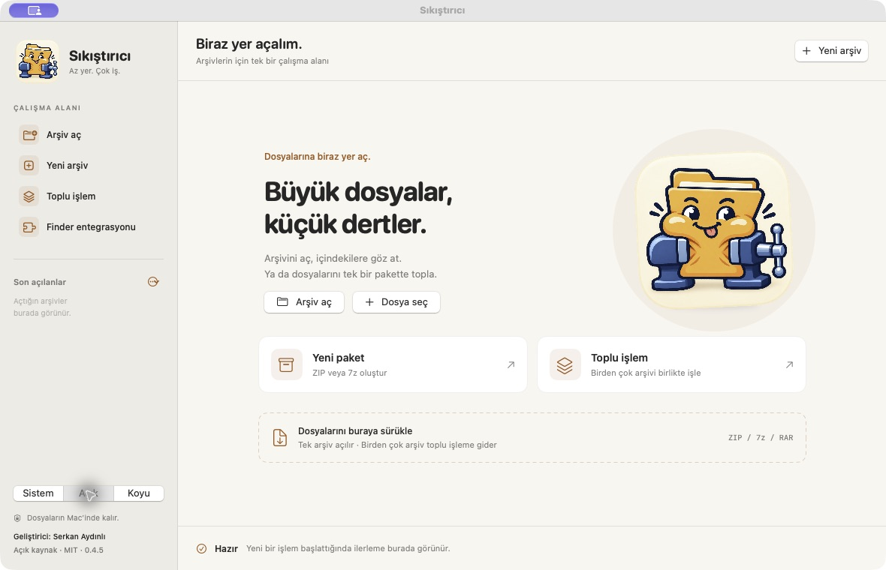

# Sıkıştırıcı


**Az yer. Çok iş.** Türkçe, yerel çalışan, açık kaynak macOS arşiv uygulaması.

**Geliştirici: Serkan Aydınlı** · **0.4.5 beta** · **MIT**

[**macOS uygulamasını indir ↓**](https://github.com/serkanaydinli/sikistirici/releases/download/v0.4.5/Sikistirici-0.4.5-macOS-arm64.zip) · [Tüm sürümler](https://github.com/serkanaydinli/sikistirici/releases) · [Hata bildir](https://github.com/serkanaydinli/sikistirici/issues)

Apple Silicon · macOS 14+ · SwiftUI · ZIP / 7z / RAR



## Neler yapar?

- ZIP, 7z ve RAR arşivlerini açar, içerikte arama yapar ve seçili dosyaları çıkarır.
- ZIP/7z oluşturur; 7z için AES-256 parola ve dosya adı şifrelemesi sunar.
- Toplu işlemler, parçalı arşivler, sıkıştırma profilleri ve dosya filtreleri içerir.
- Türkçe Windows-1254 / DOS CP857 ZIP adlarını okumayı destekler.
- Uygulama içi Quick Look önizlemesi, içerik analizi ve bütünlük testi sunar.
- ZIP/7z düzenlemelerini doğruladıktan sonra kaydeder; hata veya iptalde çıkarma değişikliklerini geri almaya çalışır.
- Finder servisleri, FinderSync/Quick Look uzantıları, açık/koyu görünüm ve hareketli maskot içerir.

Dosya işlemleri Mac üzerinde yapılır. Bulut hesabı gerekmez. RAR oluşturulmaz.

## Gereksinimler ve kurulum

- Apple Silicon (M1 veya sonrası) Mac; macOS 14 veya sonrası.
- Kaynaktan derleme için Swift 6.0+ içeren Xcode ve seçili Xcode geliştirici araçları.
- Intel Mac için hazır paket ve test edilmiş destek yoktur; paketlenen libarchive arm64'tür.

Hazır uygulama ZIP'ini açıp `Sıkıştırıcı.app` dosyasını Uygulamalar klasörüne taşı. Bu beta paket **ad-hoc imzalıdır; Apple Developer ID / notarization onayı yoktur**. İndirilen uygulama macOS tarafından engellenebilir. İmzalama durumu [dağıtım belgesinde](docs/DISTRIBUTION.md) açıklanır.

## Kaynaktan derleme

Depoyu indirip açtıktan sonra depo kökünde:

```sh
git clone https://github.com/serkanaydinli/sikistirici.git
cd sikistirici
swift --version
swift test --disable-sandbox
./scripts/build-app.sh
open 'dist/Sıkıştırıcı.app'
```

Betik uygulamayı, Finder ve Quick Look uzantılarını derler; yerel imzaları doğrular. Sonuç `dist/Sıkıştırıcı.app`, paketleme önbelleği `.build/package/` içindedir. Bu klasörler Git'e eklenmez. Normal derleme ağ bağlantısı veya Apple Developer sertifikası istemez; gerekli motor, statik kütüphane ve görseller depodadır.

Çıktıları başka konuma almak için `SIKISTIRICI_BUILD_DIR` ve `SIKISTIRICI_APP_PATH` değişkenlerini mutlak yollarla ayarla. Developer ID ile dağıtım için [DISTRIBUTION.md](docs/DISTRIBUTION.md).

## Kullanım ve katkı

[Kullanım kılavuzu](docs/USER_GUIDE.md) · [Katkı rehberi](CONTRIBUTING.md) · [0.4.5 sürüm notları](docs/RELEASE_NOTES.md)

Test paketi 88 test içerir: arşiv gidiş-dönüşü, şifreler, Türkçe adlar, dosya tarihleri, güvenli yollar, parçalı arşivler, iptal ve hata sonrası geri alma. Bütün arşiv biçimleri ve macOS sürümleri için uyumluluk garantisi verilmez. Varsayılan açılmış boyut sınırı 20 GiB'dır; uygulamada değiştirilebilir. Zorla sonlandırma veya elektrik kesilmesinden sonra otomatik kurtarma yoktur.

## Lisans ve geliştirici

Sıkıştırıcı'ya ait özgün kod, belgeler ve projeye özel maskot görselleri [MIT lisansı](LICENSE) ile paylaşılır. **Copyright © 2026 Serkan Aydınlı.** Maskot görselleri bu proje için yapay zekâ ile üretildi.

Üçüncü taraf bileşenlerin lisansları MIT ile değiştirilmez: 7-Zip LGPL/BSD ve unRAR koşullarıyla, libarchive BSD türü koşullarıyla kullanılır. Test örnekleri de kendi kaynak bildirimlerini taşır. Ayrıntılar [THIRD_PARTY_NOTICES.md](THIRD_PARTY_NOTICES.md) içinde.

7-Zip 26.04'ün eşleşen kaynak arşivi ve tam LGPL metni `Vendor/7zip/` altında bulunur; derlenen uygulamaya da eklenir. Üçüncü taraf lisans ve kaynak dosyalarını dağıtımlardan çıkarmayın.
